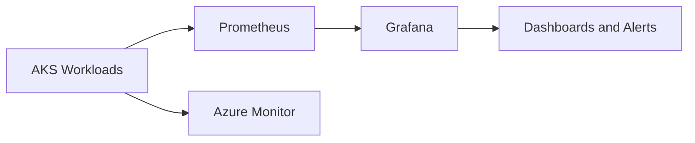

# AKS Observability Platform

This repository provides a reference observability baseline for Azure Kubernetes Service using Prometheus, Grafana, Azure Monitor integration, and SRE-friendly alerts.

